# 帧寻 GongJ!ng? · 教程卡点助手

**跟着教程，卡住就截图。**

帧寻把教程视频里的画面、语音和字幕整理成可追问、可回看的学习工作台。导入视频后，可以按时间梳理操作步骤，也可以贴上自己的屏幕截图，询问「我卡在哪一步，下一步该怎么做？」；回答里的时间点可以带你回到对应画面。

[演示视频](#演示视频) · [界面预览](#界面预览) · [主要能力](#主要能力) · [本地启动](#跑起来) · [配置说明](#配置backendenv) · [开发与测试](#测试) · [部署文档](#部署与更多文档)

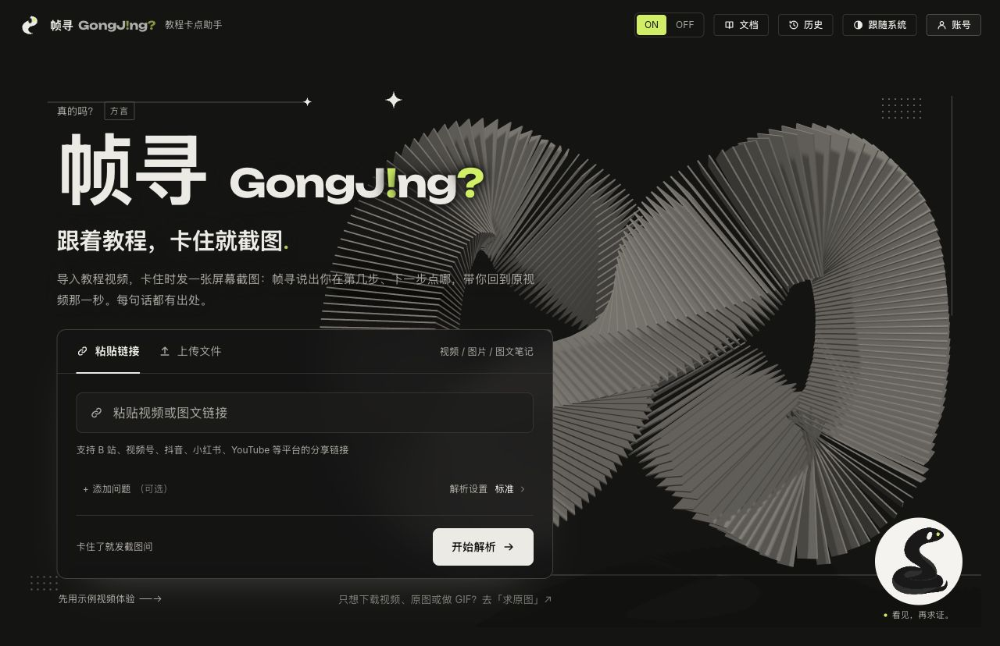

## 演示视频

来自项目 `feat/promo-video` 宣传片工程的两部实机演示成片。点击封面打开 MP4；本地也可打开 [视频播放页](docs/media/index.html) 连续查看。

| 实机操作剪辑 · 78 秒 | 功能巡览 · 87 秒 |
| --- | --- |
| [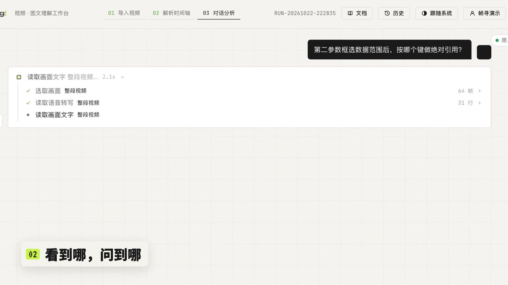](docs/media/zhenxun-demo-cut.mp4) | [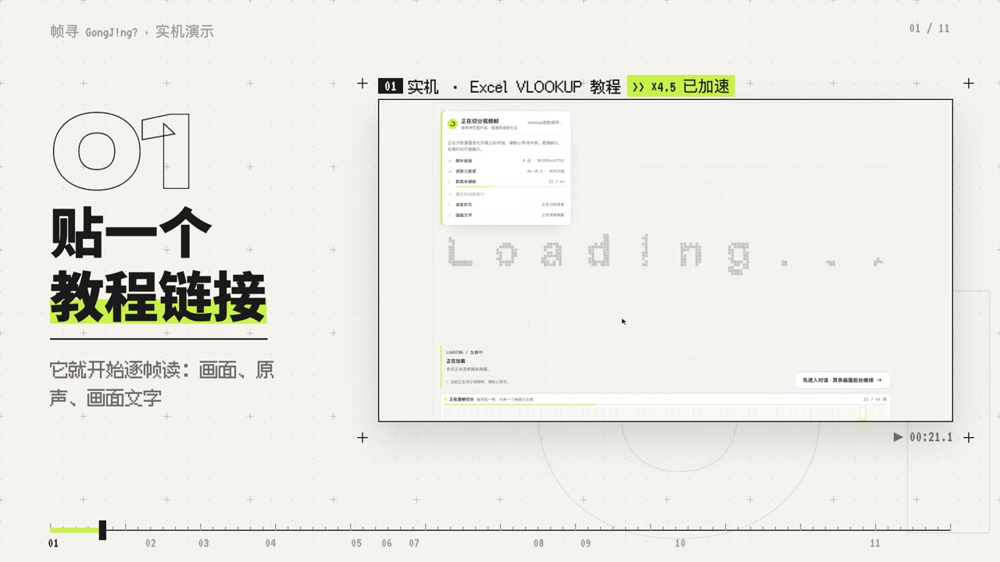](docs/media/zhenxun-reel.mp4) |
| [播放／下载 MP4](docs/media/zhenxun-demo-cut.mp4) | [播放／下载 MP4](docs/media/zhenxun-reel.mp4) |

视频沿用已有 v4 成片，保留音轨与原有剪辑，提供 720p 版本（每部约 7 MB）。片中部分操作经过加速，不能用成片时长衡量实际解析速度。素材来源与处理记录见 [媒体说明](docs/media/README.md)。

## 主要能力

| 场景 | 可以做什么 |
| --- | --- |
| 跟着教程做 | 梳理操作步骤，附上自己的截图提问，结合教程画面分析卡点与下一步 |
| 找回关键一秒 | 章节导航、关键帧时间轴、区间慢放和补看画面；点击回答中的时间点回看证据 |
| 还原 Blender 节点 | 用「抄作业」整理节点、连线和参数，在独立画布查看，复制 Blender 脚本或下载 `.py`；标出看不清的参数和版本差异。本机版装上「帧寻 Bridge」插件后，可以一键应用到打开的 Blender，并「对答案」指出少了哪个节点、哪根线、哪个参数不对 |
| 整理学习笔记 | 生成并编辑图文笔记，导出 Markdown、长图，或通过浏览器打印保存 PDF |
| 追问与查证 | 按需检索语音转写、画面文字、评论与弹幕，搜索网页和论文；工具执行过程可展开查看 |
| 多种素材导入 | 视频链接、本地视频、图片与图文内容；保留会话，方便继续追问 |

B 站与视频号使用内置解析器；抖音、小红书、YouTube 等额外平台通过可选的 **alcedo** 接入，实际可用性取决于平台、登录态和网络环境。模型输出可能有误；节点图里的待确认项需要对照原片核实，导出的脚本也可能需要手动补全。

## 界面预览

本页共展示 **12 张真实界面图**：首页、Blender 工作台和节点画布截于 **2026-10-25 本地版本**；其余画面提取自宣传片工程中 **2026-10-22 的线上实机录屏**，示例主要是 Excel VLOOKUP 教程。两批素材的主题、文案和入口可能不同；没有使用设计稿或模拟 API 界面。

### 对话、章节与时间轴

对话区查看教程分析，右侧工作台切换步骤、对照、章节和笔记；下方时间轴区分关键帧、慢放帧、补看帧与回答引用的时间点。

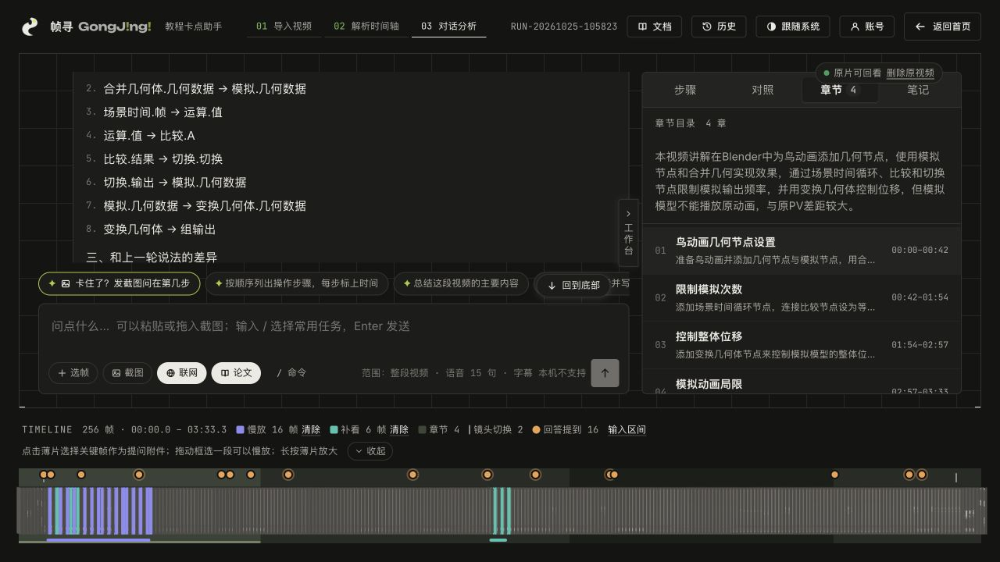

### 从教程到节点画布

「抄作业」结果可以打开为独立节点画布，查看连线、参数、版本说明和待确认项，并导出 Blender 脚本。

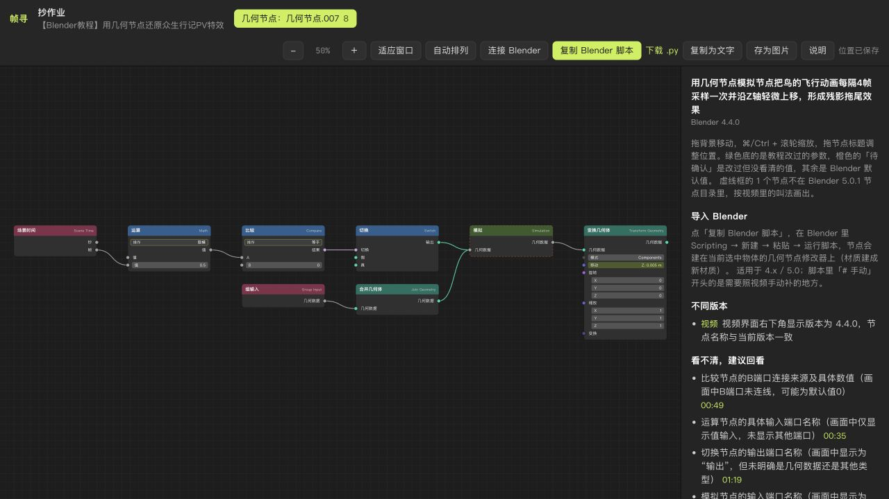

### 教程导入与截图提问

导入时展示抽帧、语音和画面文字的处理进度。卡住后可以附上自己的屏幕截图，继续询问所在步骤和下一步操作。

| 导入与解析进度 | 附上自己的截图 |
| --- | --- |
| 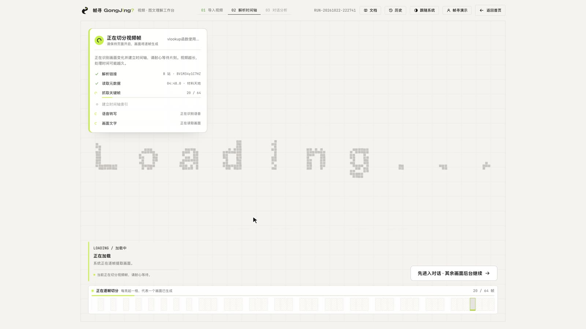 | 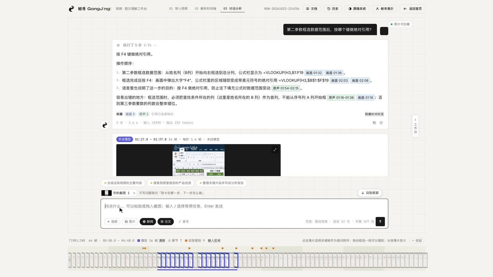 |

### 回答有时间，依据能回看

回答区区分画面与原声引用；点击时间标签打开原片播放器，也可以框选时间区间逐帧慢放。

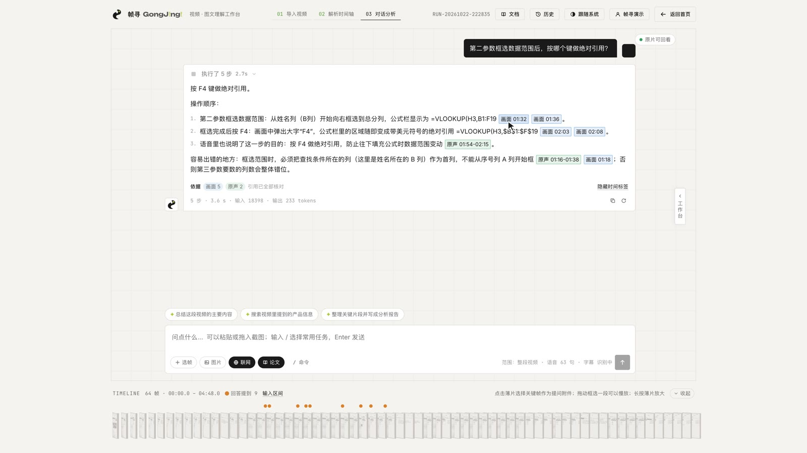

| 点击引用回到原片 | 区间慢放与逐帧查看 |
| --- | --- |
| 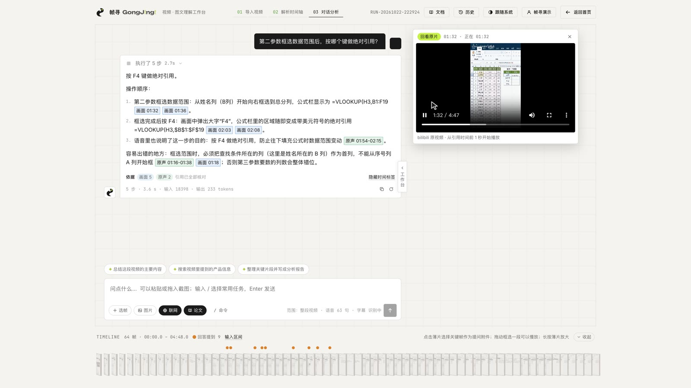 | 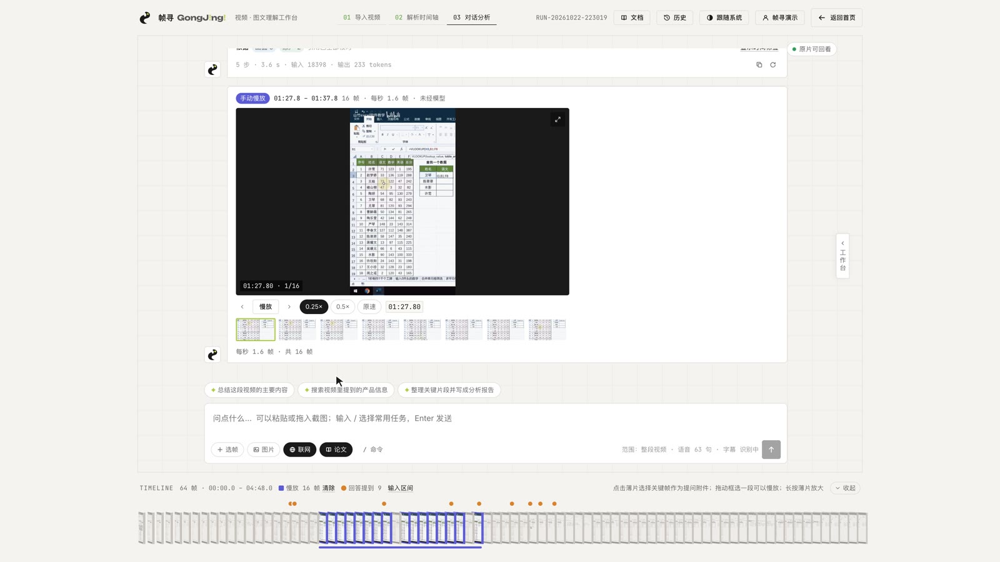 |

### 学习笔记与片段制作

把教程整理成图文笔记并预览导出；需要保存视频片段时，可以调整区间、尺寸、帧率和速度，生成 GIF。

| 图文笔记导出预览 | GIF 片段制作 |
| --- | --- |
| 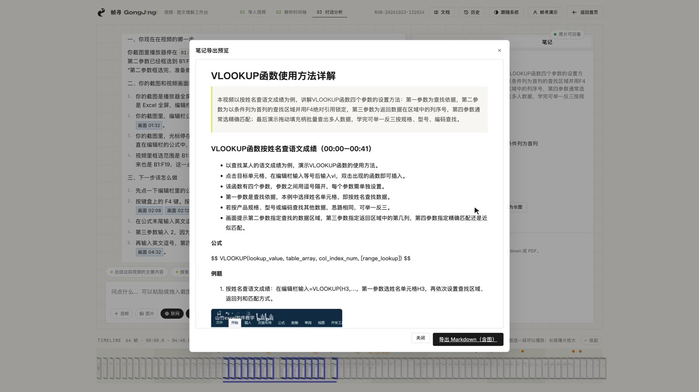 | 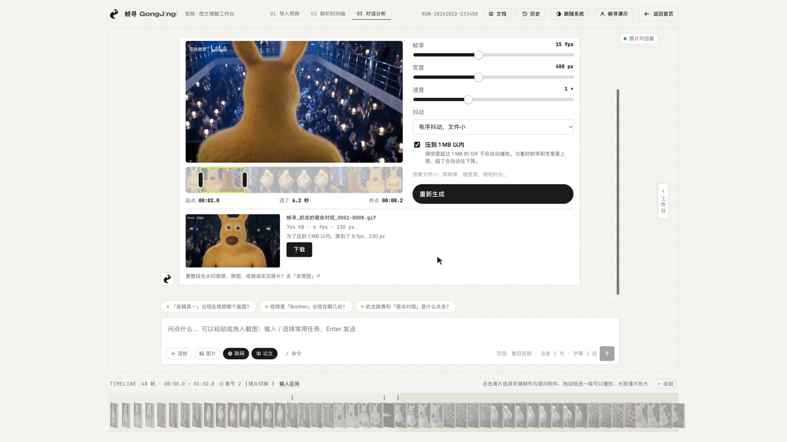 |

### 手机端也能选帧和整理笔记

手机端提供大图网格选帧，以及笔记编辑、导出和长图入口。

<p align="center">
  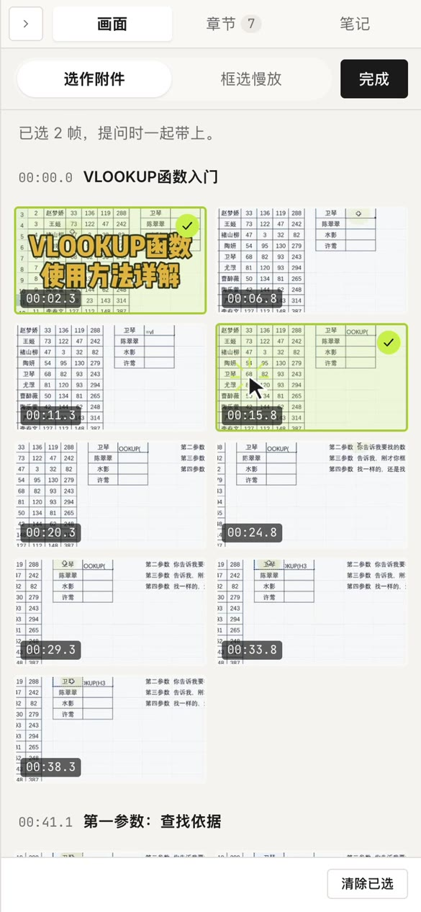
  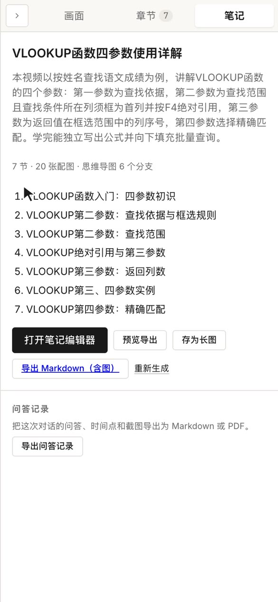
</p>

截图原文件及更新说明见 [docs/screenshots](docs/screenshots/README.md)。

## 使用流程

1. **导入教程**：粘贴分享链接或上传文件，按需选择快速、标准或精细解析。
2. **定位问题**：浏览章节和时间轴，直接提问，或粘贴／拖入自己的屏幕截图。
3. **回看依据**：展开工具步骤，点击时间点回到原片；需要观察细节时指定区间慢放。
4. **保存成果**：整理笔记，或把 Blender 教程的节点图和脚本带到自己的工程中。

## 跑起来

支持 macOS（Apple Silicon）和 Linux 两种环境，语音转写和画面文字识别按平台自动选择后端，也可用 `ASR_BACKEND` / `OCR_BACKEND` 手工切换（见下表）。需要 Python 3.11+、[uv](https://docs.astral.sh/uv/)、Node.js（建议 20+）和 ffmpeg：

```bash
# macOS（Apple Silicon）：brew install uv node ffmpeg
# Linux（x86_64 / aarch64）：dnf install -y python3.11+ nodejs ffmpeg  # 或 apt 等价命令
```

在 `backend/.env` 写入配置（不要提交真实密钥）。使用默认云端模型时，最小配置为：

```dotenv
DEEPSEEK_API_KEY=替换为你的密钥
```

然后在项目根目录运行：

```bash
./dev.sh          # 检查环境 → 安装依赖 → 同时启动后端和前端，打开 http://localhost:5173
./dev.sh --check  # 只检查，不启动
```

### 两个平台的识别后端

| | macOS 默认 | Linux 默认 | 手工切换 |
| --- | --- | --- | --- |
| 语音转写 | mlx-whisper（`whisper-large-v3-turbo`） | faster-whisper（CPU int8，默认 `small`，`ASR_CPU_THREADS` 控制线程数） | `ASR_BACKEND=mlx` / `faster-whisper` |
| 画面文字 | macOS Vision | RapidOCR ONNX | `OCR_BACKEND=vision` / `rapidocr` |

- Apple Silicon macOS 上，mlx-whisper 与 Vision 依赖按平台标记安装。
- Linux 上安装云端可选依赖组：`cd backend && uv sync --extra cloud`（faster-whisper + rapidocr-onnxruntime）。未安装对应依赖时，语音转写或文字识别能力会不可用，仍可使用可用的画面分析能力。
- **headless Linux（无 libGL）注意**：rapidocr-onnxruntime 声明依赖非 headless 的 `opencv-python`（要 libGL，且与项目用的 `opencv-python-headless` 都装 `cv2`，互相破坏）。pyproject 的 `[tool.uv] exclude-dependencies` 已把它从解析里排除，uv 0.12.9 本地解析与锁定已验证；无 libGL 的 openEuler aarch64 实测的是下述 pip 路径，Linux 的 uv 路径仍待部署环境验证。没有 uv 时用 `deploy/huawei/prepare.sh` 的等价 pip 序列：先装 `opencv-python-headless`，再 `--no-deps` 装 `rapidocr-onnxruntime` 并显式补上它的真实依赖（onnxruntime、numpy、Pillow、pyclipper、PyYAML、Shapely、six、tqdm）——不要先装 rapidocr 再手动卸装 opencv-python，那会同时损坏 headless 的 cv2。
- Linux 的 ASR 模型默认 `small`；下载不动 Hugging Face 时可改用 ModelScope 转换权重（见 [deploy/huawei/README.md](deploy/huawei/README.md)），设 `ASR_MODEL=/本地权重路径`。
- 云端（无本地 Ollama）问题分类由主模型在 5 秒内完成（见配置表的 `INTENT_LLM_FALLBACK`），超时才退回关键词规则。

`dev.sh` 会做这些事：

- 检查工具、`.env` 里的配置（只看有没有，不显示值）、Ollama 和决策模型；缺少必需项时停下并说明。
- 后端依赖有变化时执行 `uv sync`，前端缺依赖时执行 `npm install`。
- 8000 / 5173 上如果还跑着之前启动的本项目服务，先停掉再启动，保证运行的是最新代码；被别的程序占用则报出进程并退出，不会动它。
- 后端带 `--reload` 运行，**改代码或 `.env` 都会自动重载**；两边的日志合在一个窗口里，用 `[api]`、`[web]` 区分；Ctrl+C 两边一起停。
- 想同时跑第二份（例如测试）而不影响正在用的：`API_PORT=8011 WEB_PORT=5191 GONGJING_DATA_DIR=/某个临时目录 ./dev.sh`。

## 配置（`backend/.env`）

`.env` 已被 git 忽略。环境变量与 `.env` 同名时，环境变量优先。

平台登录（B 站、腾讯元宝）不用手动复制 Cookie：点页面右上角「账号」→「扫码登录」，用对应的 App 扫码确认即可。登录结果保存在 `backend/.env.accounts`（同样被 git 忽略、只有本机用户可读），优先于 `.env` 里的同名项；页面上只显示是否登录、账号名和到期日，不显示 Cookie 本身。单独存一个文件是因为 `dev.sh` 会在 `.env` 变化时重启后端，正在进行的回答会被打断。

| 配置 | 必需 | 作用 |
| --- | --- | --- |
| `DEEPSEEK_API_KEY` | 二选一 | 问答模型（默认 `deepseek-flash`，可用 `LLM_BASE_URL` / `LLM_MODEL` 换成其他 OpenAI 兼容服务） |
| `LLM_PROVIDER=ollama` | 二选一 | 改用本机 Ollama 做问答（默认 `qwen3.5:9b`），不需要 key，但慢得多 |
| `TAVILY_API_KEY` | 可选 | 联网搜索备用（首选是 DeepSeek 搜索，用同一个 `DEEPSEEK_API_KEY`），每月 1000 次免费；都没有时退到免费的 ddgs |
| `OPENALEX_API_KEY` | 建议 | 论文检索；不带 key 每天约 100 次，带免费 key 约 1000 次 |
| `YUANBAO_COOKIE` | 视频号需要 | 腾讯元宝登录态 `hy_user=…; hy_token=…`，用来解析视频号链接；会过期。**可以直接在页面右上角「账号」里用微信扫码登录** |
| `BILIBILI_COOKIE` | 可选 | B 站登录态（`SESSDATA=…`），用来读更多评论；不配置时 B 站只给前 3 条热门评论，弹幕不需要登录。**可以在「账号」里用 B 站 App 扫码登录** |
| `ALCEDO_BIN` / `ALCEDO_URL` | 可选 | 额外平台解析：本地 alcedo 可执行文件或 `alcedo serve` 地址；可运行 `./scripts/install-alcedo.sh` 安装 |
| `SCREENTEXT` | 可选 | 画面文字识别（每秒一帧读出字幕和画面上的字，默认开启）；`SCREENTEXT=off` 关闭。后端见上方"两个平台的识别后端" |
| `BROWSER` | 可选 | 浏览器操作（Playwright 无头 Chromium，默认开启，跟"联网"开关走）；第一次要下载浏览器：`cd backend && uv run playwright install --only-shell chromium`；`BROWSER=off` 关闭 |
| `DECISION` / `DECISION_MODEL` | 可选 | 决策模块（本机 Ollama，默认开启、`qwen3.5:9b`）：过滤搜索结果、拦截网页注入、判断是否需要查资料；Ollama 没开时自动退回简单规则 |
| `INTENT_LLM_FALLBACK` | 可选 | 问题分类的主模型回退（默认开启）：本地决策模型不可用时，由问答主模型在 `INTENT_LLM_FALLBACK_TIMEOUT`（默认 5）秒内从六个固定类别中选一，超时或答不出才退回关键词规则；`off` 关闭。回退的 token 用量与前台等待耗时记录在路由事件里，供预算统计；耗时不含返回后继续完成的后台连接清理 |

其余配置项（转写模型、搜索引擎顺序、工具轮数等）见 [backend/README.md](backend/README.md)。

## 目录

```
dev.sh            一键检查与启动
backend/          FastAPI 后端：链接解析、抽帧、语音转写、问答与工具调用、决策模块、会话存储
  README.md       后端说明：接口、每个模块的做法与实测结果、全部配置项
front/            React + Vite 前端：导入、对话、时间轴、工作台、笔记、节点画布
docs/
  screenshots/    README 使用的真实界面截图
  design.md       最初的需求说明
  design_2.md     前端设计规范（视觉 token、组件、动效、对话界面）
deploy/           Linux、华为云与容器部署说明
scripts/          可选工具安装脚本
datas/            测试数据（解析器用例）与开发过程中导出的对话记录
```

运行时数据（抽到的帧、会话数据库 `sessions.sqlite3`）在 `backend/data/`，不进 git。

## 测试

```bash
cd backend && uv run pytest               # 后端单元测试，不联网
cd backend && uv run python scripts/check_links.py   # 用 datas/ 里的真实链接验证 B 站解析（联网）
cd front && npm run build                 # 前端构建检查
cd front && npm run test:e2e              # 前端端到端测试（Playwright）
cd backend && uv run python scripts/eval.py --judge   # 回答质量评测：29 道固定题，真实模型，约 5 分钟
cd backend && uv run python scripts/log_stats.py      # 最近 7 天的使用统计：耗时、token、工具、失败原因
```

**回答质量评测**（`backend/evals/cases.json`）：7 个真实视频（B 站 5 个、视频号 2 个）上的 29 道题，覆盖转写里的事实和时间点、细看某段画面、视频里没说的事（要说没提到而不是编造）、查资料和核实说法、关掉联网、只问选中的帧、评论区和弹幕、视频号评论读不到、浏览器、没有口播的视频。每题有自动检查（必须/不能调用哪些工具、回答里必须/不能出现什么、有没有引用时间点），加 `--judge` 时再由模型按评分标准打分。脚本自己起一个后端（数据在 `backend/data/evals`，不影响正在用的），视频只解析一次，每题不带对话历史；结果存在 `backend/data/evals/results/`，并和上一次对比通过率、耗时和 token。改提示词、换模型、调工具之后跑一遍，看有没有退步。模型评分有一定随机性，单题从 2 分掉到 1 分先看回答本身再下结论。

**日志**：后端把每次回答（耗时、token、调用了哪些工具及各自耗时、失败原因）、链接解析、抽帧、转写、扫码登录和未处理的异常写成 JSON 行，存在 `backend/data/logs/日期.jsonl`（保留 30 天），终端里同时打一行摘要。`log_stats.py` 汇总这些日志，加 `--errors` 列出最近的失败和堆栈。

前端端到端测试（`front/e2e/`）在真实的 Chromium 里操作页面，但所有 `/api` 请求都由 `e2e/mock-api.js` 在浏览器内直接应答，所以不需要启动后端、不联网、不花模型费用，结果每次都一样。覆盖：解析链接 / 本地上传 / 解析失败、回答里步骤与文字的顺序、时间点和链接、来源卡片、搜索步骤的可视化、联网开关随问题发送、`/` 命令菜单、时间轴收起与自动展开、停止、重新回答、历史会话（新旧两种保存格式）。

- 测试时禁用了 WebGL：无头浏览器里雕塑用软件渲染、每帧回读像素，会把页面拖到按钮一直无法点击；页面因此显示设计规范要求的静态替代图，这条路径也一并测到。
- 测试自己起一个 Vite（5199 端口），不影响 `./dev.sh`。第一次运行如果提示缺少浏览器：`npx playwright install chromium`。
- 失败时 `front/test-results/` 里有截图、页面快照和可回放的 trace（`npx playwright show-trace …`）。

## 部署与更多文档

- [后端说明](backend/README.md)：API、模块实现、模型和解析配置。
- [华为云部署](deploy/huawei/README.md)：openEuler / aarch64 环境准备与识别依赖。
- [容器部署](deploy/linyi/README.md)：服务部署与运行配置。
- [前端自定义](docs/frontend-customization.md)：文案、视觉和界面配置。

前端使用 React 18、Vite、Three.js 与 GSAP；后端使用 Python、FastAPI、SQLite 和 ffmpeg，通过 SSE 推送解析与问答过程，模型接口兼容 OpenAI 协议，也支持本地 Ollama。
