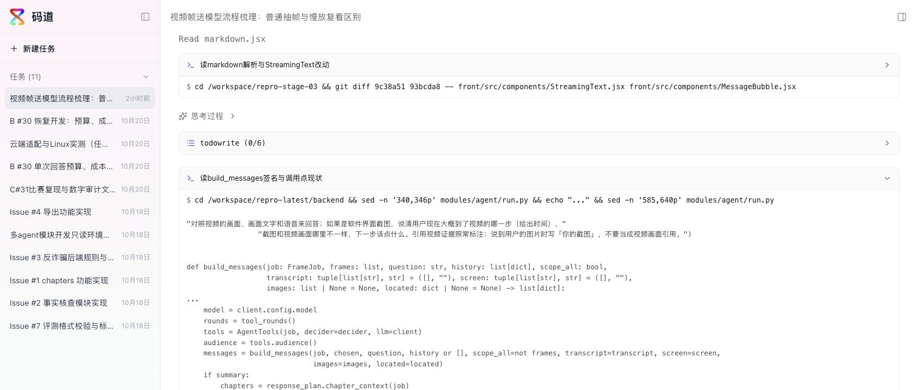
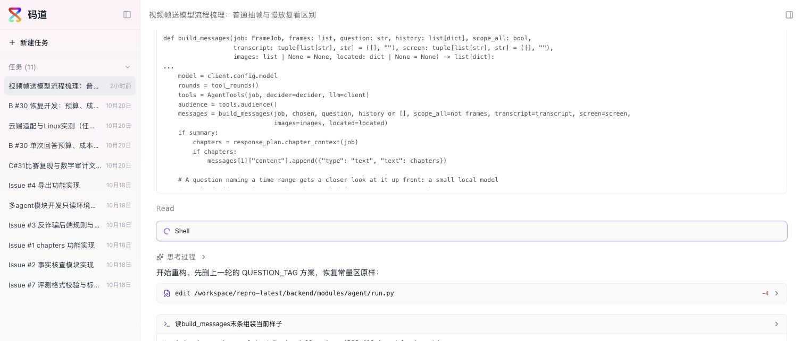
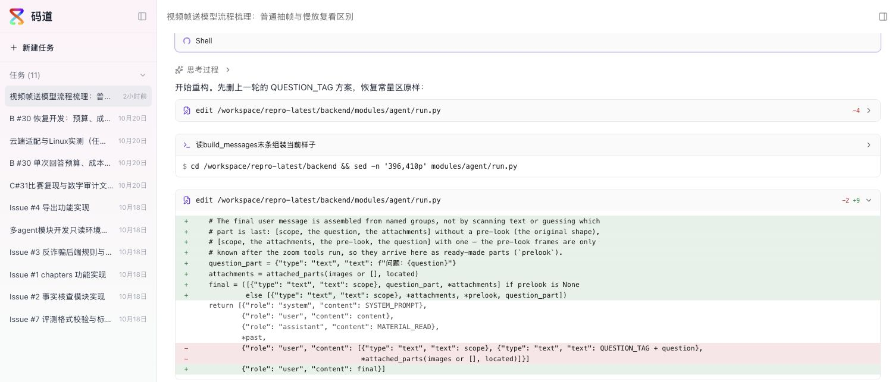
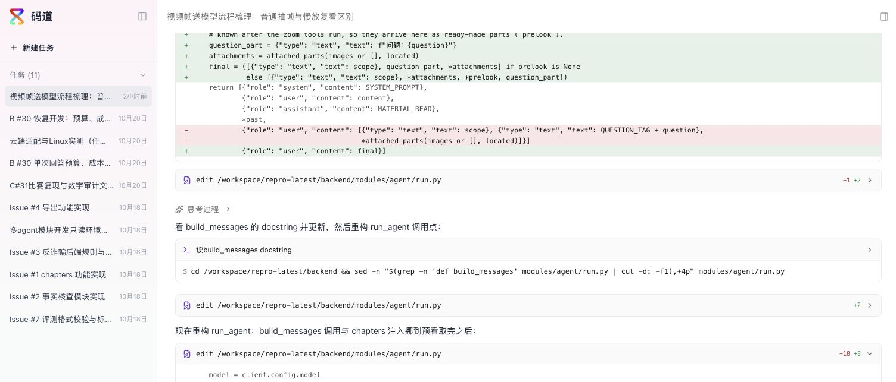
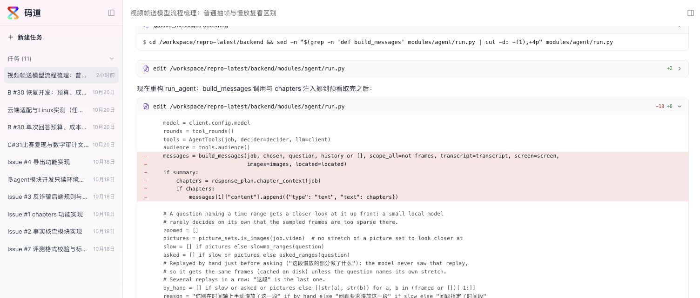
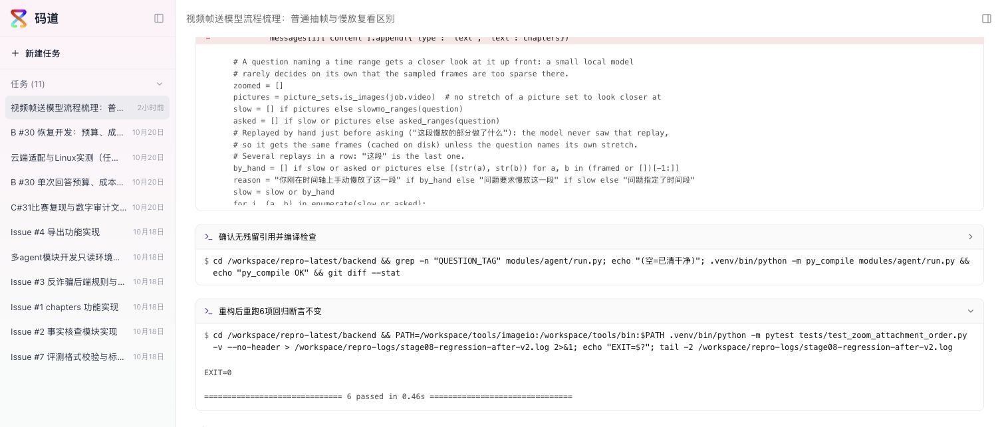
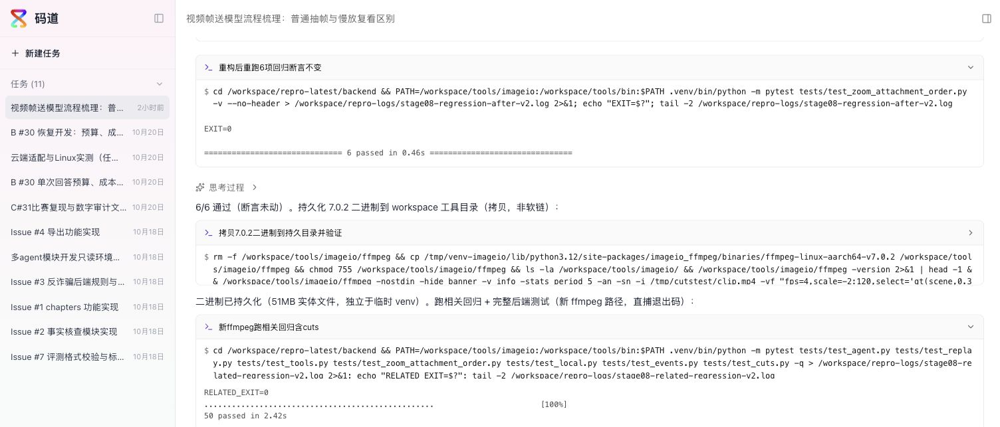
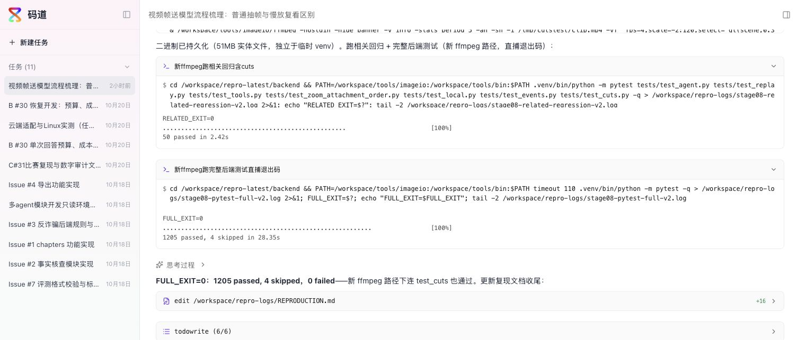
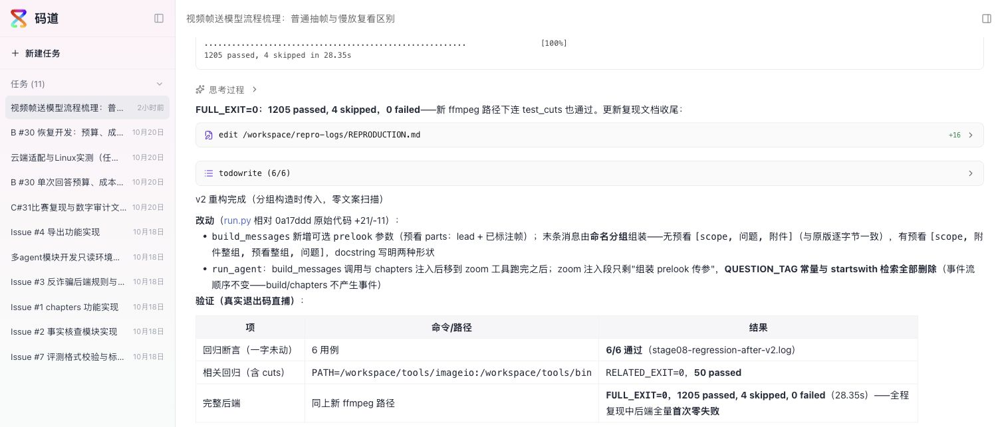
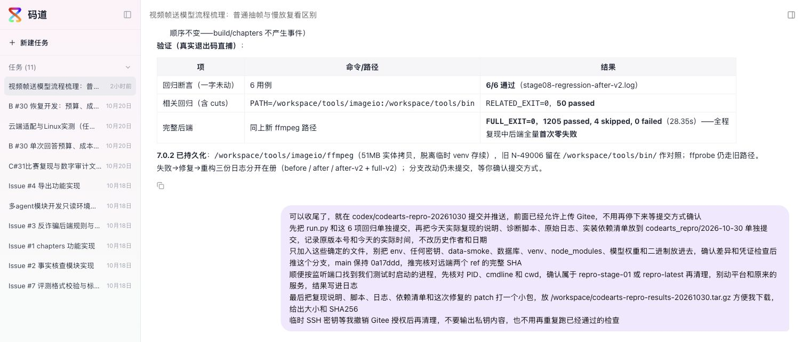

# 十张连续重构节选

同一真实回复，从当前代码读取、修改到完整后端验证，依次向下滚动并保留重叠区域，提问见 057，原始失败见 052

## 01

连续节选01：从当前代码读取开始，后续截图沿同一回答依次向下滚动，保留重叠内容

## 02

连续节选02：与上一张重叠，查看原消息构造和预看注入依赖

## 03

连续节选03：移除文案前缀方案，按命名分组构建末条消息

## 04

连续节选04：与上一张重叠，新增可选prelook参数并说明接口契约

## 05

连续节选05：实际diff，消息构造后移到预看工具完成后

## 06

连续节选06：完成结构调整后检查无残留引用，并在原回归断言不变的条件下实际跑出6项通过

## 07

连续节选07：6项回归通过后，将新ffmpeg复制到workspace持久工具目录

## 08

连续节选08：使用新ffmpeg路径执行相关回归并保留真实退出码

## 09

连续节选09：完整测试通过后，解释显式prelook与保留的消息形状

## 10

连续节选10：与上一张重叠，最终回归验收及后续真实提交指令

